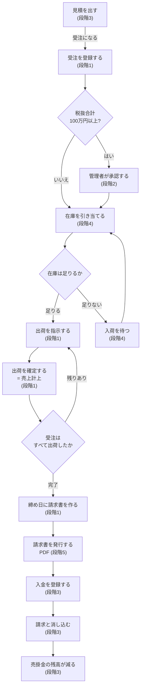
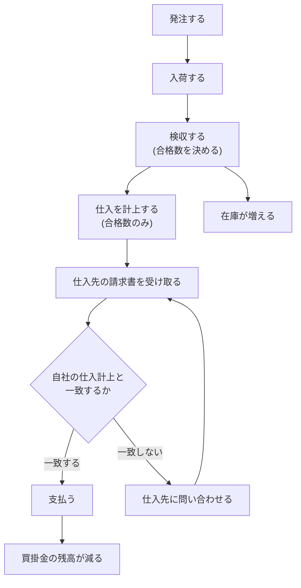
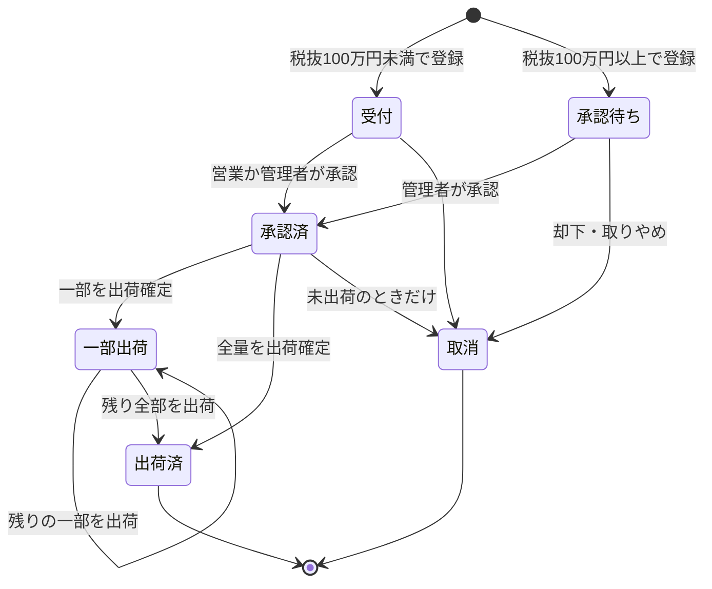
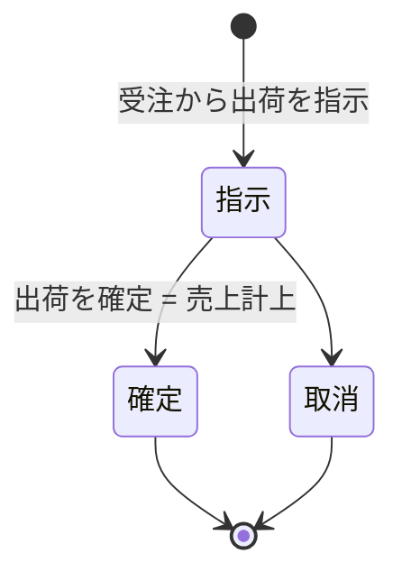
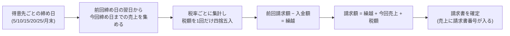
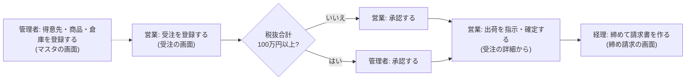

# 業務フロー

用語は`glossary.md`、判断の決まりは`business-rules.md`に従う。図の中の括弧は段階（どの段階で作るか）。段階1（API）と段階2（画面・ログイン・権限・承認）の部分は作ってある（2026-11-11）。誰がどの操作をするかは「5. 誰が操作するか」。

## 1. 販売の流れ（受注から入金まで）

**分納**: 「出荷を確定する」から「受注はすべて出荷したか」で残りがあれば、再び出荷指示に戻る。受注明細の出荷済み数量で判定する。

## 2. 購買の流れ（発注から支払まで・段階4）

## 3. 受注の状態（段階1・承認は段階2）

**出荷済みの受注は取り消せない。** 出荷後に誤りが見つかった場合は、赤伝で打ち消す（`business-rules.md`の「締めた後に誤りが見つかったら」）。

**返品しても状態は戻らない。** 返品は負の売上として計上し、受注の状態と出荷済み数量はそのまま（`business-rules.md`の「返品」）。状態ごとにできる操作の表は`business-rules.md`の「状態」にある。

承認待ちは 2026-10-29（段階2）に足した。登録した時の税抜合計で、受付か承認待ちのどちらで始まるかが決まる（本人の決定。100万円は設定の既定値。`business-rules.md`の「承認」）。それまでのコードでは、受付から金額を問わず承認済へ進んでいた。

### 出荷の状態（段階1）

受注の出荷済み数量と状態が動くのは、出荷を確定したときだけ。確定した出荷は取り消せない（打ち消すのは返品）。

## 4. 締めと請求（段階1）

**締め済みの売上は二重に請求しない。** 売上に請求書の参照が入っているかどうかで判定する。

## 5. 誰が操作するか（段階2）

役割ごとにできる操作の唯一の定義元は `business-rules.md` の「役割」の表。ここでは、段階2で作った画面の流れに、誰が手を動かすかを重ねる（管理者はどの操作もできるので省く）。

- **ログインしていなければ、どの画面も使えない。** 役割の無い操作のボタンやリンクは出ず、URL を直接開いても 403 の理由が出る（守りはユースケースの入口の検査）。
- **役割を外したり利用者を無効にしたりすると、画面では1分以内に効く**（`business-rules.md`「8.」）。API のトークンは期限の1時間まで通る。
- 利用者を作る・役割を変える画面はまだ無い。初期の利用者は各自の user-secrets から作る（`CLAUDE.md` の「DBの準備」の4）。
